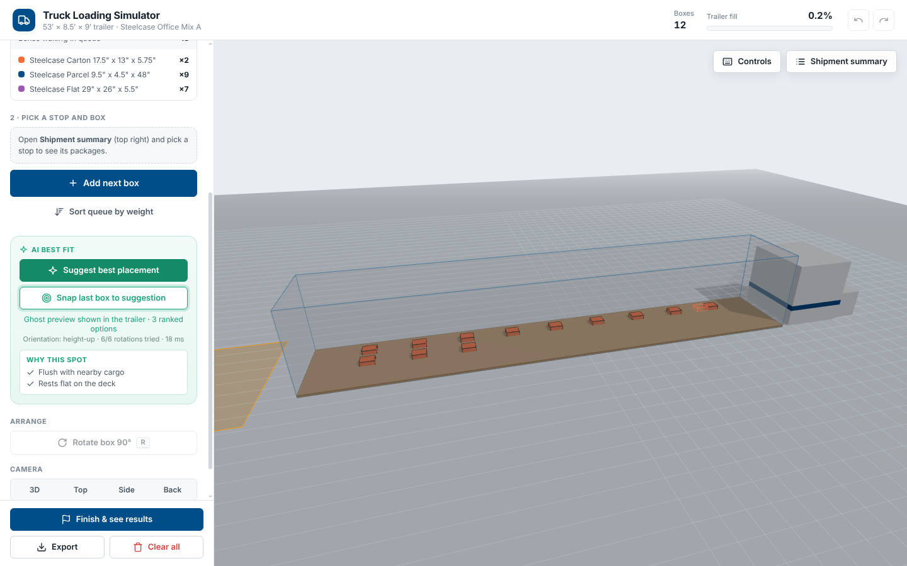

# Truck Loading Simulator

A 3D, physics-backed truck loading trainer built for Steelcase. Load a 53′ trailer box by box, get AI best-fit placement suggestions, and see how efficiently you packed it.



## Features

- **Drag-and-drop loading** in a 53′ × 8.5′ × 9′ trailer with real collision and physics (three.js + cannon-es)
- **Load examples or your own CSV** of Steelcase shipments, with per-stop filtering
- **AI best fit**: ranked placement suggestions with a ghost preview and a "why this spot" explanation
- **Fragile and stability checks** that warn before a box is crushed or left unsupported
- **Session results** with a utilization grade, plus load-plan export
- **Works on phones**: the controls collapse into a bottom sheet

## Getting started

Needs [Node.js](https://nodejs.org) 20 or newer.

```bash
npm install
npm start          # opens the app at http://localhost:5173
```

Other scripts:

| Command | What it does |
| --- | --- |
| `npm test` | Unit tests for placement scoring and best-fit search |
| `npm run build` | Production build into `dist/` |
| `cd sandbox && npm test` | Tests for the CSV and dataset pipeline (see [`sandbox/README.md`](sandbox/README.md)) |

Add `?debug` to the URL to show the FPS counter.

## Controls

| Action | Input |
| --- | --- |
| Rotate / zoom / pan the view | Left drag / scroll / right drag |
| Move a box | Click and drag |
| Raise / lower while dragging | `W` / `S` or `↑` / `↓` |
| Rotate 90° | `R` |
| Tilt or roll | Double-click a box |
| Group select | `Shift` + click |
| Undo / redo | `Ctrl+Z` / `Ctrl+Y` |

## Project layout

```
src/            React app: scene, drag/physics, best-fit search, UI
src/index.css   Design tokens and all UI styles
sandbox/        Headless CSV → load plan → ML dataset pipeline
docs/           Research reports, performance report, screenshots
```

